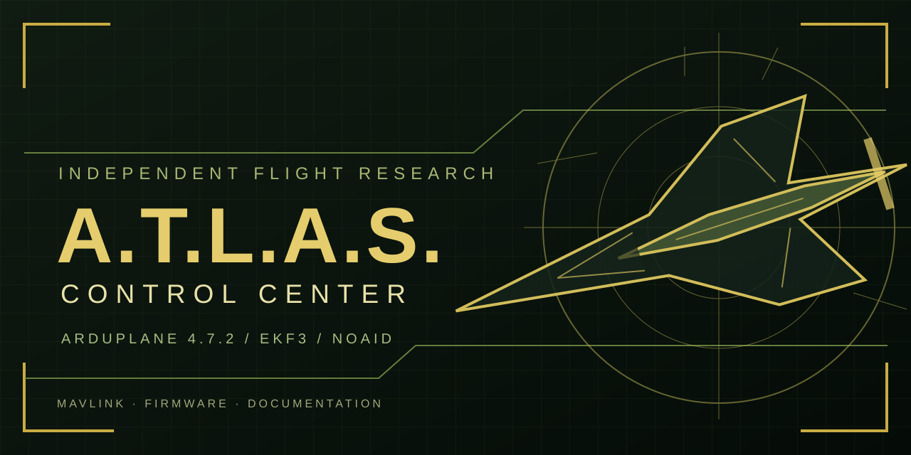

# A.T.L.A.S. · Control Center

**Independent ArduPlane 4.7.2 research project and multilingual flight-controller web tools**

> [!WARNING]
> **Experimental flight-control software.** GPS-denied navigation, automated flight modes and browser-based DFU must be verified against each specific aircraft and board. Remove propellers for bench tests. A.T.L.A.S. is **not an official ArduPilot release**.

## Overview

A.T.L.A.S. is an independently developed experimental extension of **ArduPlane 4.7.2**, accompanied by a browser-based **Control Center**. Development includes EKF3/NOAID research without GPS, air-data fusion, modified TAKEOFF/CRUISE and failsafe behavior, and tools for aircraft setup.

| Area | What the Control Center is designed for |
| --- | --- |
| **Flight telemetry** | MAVLink, live attitude and a separate interactive aircraft demo |
| **Configuration** | Parameters, PID tuning, flight modes, radio and servo outputs |
| **Calibration** | Accelerometer, compass and relevant sensor setup |
| **OSD / hardware** | Screen layout editor, camera gimbal, parachute settings |
| **Firmware** | Versioned HEX catalog, checksums and rollback selection |
| **Guides** | FAQ, differences from upstream ArduPlane, release history |
| **Community** | Manual donation transfers and opt-in early-testing program |

### Language support

**Русский · Українська · English**. MAVLink and ArduPilot parameter identifiers are intentionally not translated.

## Website and releases

This repository hosts the **public website**, not the developer's private work-in-progress source repository. Published builds are intended to be served from the public site with per-board compatibility information, checksums and archived versions.

> **Release staging:** The upcoming Control Center 0.7.0 website and its private mail-server package are prepared separately. This documentation PR does **not** publish a firmware image or activate email subscriptions. Do not announce a working release until its files, hosting and hardware compatibility are verified.

Visit the repository's **GitHub Pages** deployment after the owner enables and updates Pages for the public release. Do not assume source code in a private repository is accessible to firmware recipients.

## Donate and get updates

The prepared website includes a voluntary manual **IBAN transfer** flow, an optional email sign-up form, flight-controller selection and early-tester interest. It does **not** take card payments or verify bank transfers automatically.

Email verification, newsletters and matching firmware attachments require a **separately deployed private HTTPS + SMTP service**. Subscriber databases and credentials must never be added to GitHub Pages. Early-test invitations require explicit developer approval.

## License and compliance

A.T.L.A.S. is based on the ArduPilot ecosystem. The applicable **GNU GPLv3-or-later** conditions cover distribution of the modified ArduPilot firmware. Anyone distributing a modified HEX must make the corresponding source available to recipients under the applicable GPL terms. A private development repository by itself does not meet this requirement.

**Project:** Oleksandr · AI-assisted development.  
**Upstream:** [ArduPilot](https://github.com/ArduPilot/ardupilot)  
**Website status:** pre-release, independently maintained.

---

Flight research • Open-source obligations • Responsible testing
